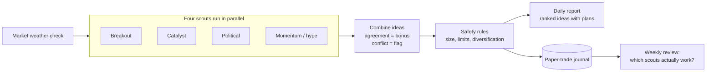

# Stock Picker

**A research assistant that looks for stock ideas from four different angles, writes down a full plan for each one, and then keeps an honest scorecard of how those ideas would have turned out. With pretend money only.**

It never buys or sells anything. It never touches a brokerage account. It is a notebook that does its homework, shows its sources, and admits when it doesn't know.

> **Not investment advice.** This is a personal research project. Every "trade" in it is a paper trade, a pretend trade written down to see what would have happened. Nothing here tells you what you should do with your money.

---

## In one minute

Imagine four scouts, each looking for promising stocks in a different way:

| Scout | What it looks for | In everyday terms |
|---|---|---|
| **Breakout** | Stocks that have been resting quietly near their highs and look ready to move up | A runner catching their breath at the front of the pack |
| **Catalyst** | Companies about to report earnings, where history suggests the odds lean one way | Checking a team's record before a big game |
| **Political** | Stocks members of Congress recently bought, where their committee oversees that company's business | Following public disclosures that lawmakers are legally required to file |
| **Momentum / hype** | Stocks people are suddenly talking about online, *if* the price is confirming the excitement | Noticing a crowd forming, and checking whether it's real |

Every evening, after the market closes, the project:

1. **Checks the weather**: is the overall market healthy, so-so, or weak? In weak markets it gets pickier and uses smaller pretend positions.
2. **Sends out all four scouts** at the same time.
3. **Combines what they found.** If two scouts like the same stock, that's a plus. If they disagree (say, a chart looks great but earnings come out in two days), that's flagged.
4. **Applies safety rules**: how much could be lost if the idea is wrong, whether we're already holding too many similar stocks, and so on.
5. **Writes a daily report** with a ranked list. Each idea has *where to get in, where to admit it was wrong, where to take profit, and why*, with a link for every number.
6. **Logs every idea to a journal** and, as days pass, marks how each one actually played out.

Once a week it reviews the journal and says plainly which scouts are helping and which are just noise.

---

## Why this project is different

Most stock-picking tools show you exciting ideas. This one is built around **not fooling yourself**:

- **Every number has a source and a date.** If data is missing, the report says so instead of guessing.
- **It grades its own homework.** Every idea, including the ones it *didn't* pick, is tracked so you can see whether the filters help.
- **It tests ideas before trusting them.** When a rule sounds smart, the project checks it against history. Several rules didn't survive (see below).
- **No hindsight cheating.** The code is tested to make sure it never uses tomorrow's information to make today's decision. Pretend trades can only be "filled" at prices that existed *after* the idea was written down.
- **No real money, ever.** There is no code anywhere that can place an order. That's a ground rule, not a missing feature.

---

## What we've learned so far (the honest part)

These are real findings from testing, written in plain terms. They're the most valuable part of the project.

**1. The chart-pattern scout is roughly break-even on its own.**
Tested on 5 years of history across 300 stocks (514 pretend trades): it was right 36% of the time, with wins averaging +10.9% and losses −7.0%. Net result: about zero, and slightly behind simply holding the S&P 500. Twelve variations of the buy and sell rules didn't fix it. Patterns that looked good in one test set reversed in the other.

**2. "Copy the members of Congress who beat the market" doesn't work.**
The political scout originally only followed lawmakers whose disclosed trades had beaten the S&P 500. We tested whether that predicts anything: across 2023–2026 and almost 3,000 purchases, members who beat the market last year did **no better** on their next purchases than members who didn't. So that rule was dropped. Worse, copied purchases *as a whole* trailed the S&P 500 by about 2% over the following six months.

**3. Scores from different scouts weren't comparable.**
The catalyst scout tends to hand out scores around 79, the breakout scout around 61. Ranking them in one list meant catalyst ideas won mostly because of how it counts points. Ideas are now ranked by how strong they are *for their own scout* (a percentile), plus each scout's actual track record once pretend trades close.

**4. Earnings plays can't meet the usual safety rule.**
The project normally requires a potential gain at least twice the potential loss. Earnings plays structurally can't hit that, so they were allowed an exception, but at half the size.

The pattern: **most clever-sounding edges shrink or vanish when tested honestly.** The project's real job is to find that out cheaply, with pretend money, before anyone uses real money.

---

## The safety rules (built into every idea)

| Rule | What it means |
|---|---|
| Only real, liquid stocks | Price at least $3, at least $10 million traded per day, listed on a major exchange. No penny stocks, no over-the-counter shares. |
| Red-flag check | Warns about recent share dilution (the company printing new shares) and reverse splits, two common signs of trouble or a pump-and-dump. |
| Small, fixed risk per idea | Each pretend trade is sized so that, if it hits its stop, it loses about **0.75% of the account**. |
| Reward must outweigh risk | Potential gain must be at least **2×** the potential loss (with the earnings exception above). |
| Don't put all eggs in one basket | At most **8** positions at once, at most **2** in the same industry, and no new idea that moves almost in lockstep with one already held. |
| Riskier ideas, smaller size | Hype ideas and earnings plays use half the normal size. In a weak market, everything shrinks. |
| A "do not touch" list | If a qualifying lawmaker recently sold most of their position in a stock, that stock is kept off the list for 90 days. |

---

## What a daily idea looks like

> **XYZ — breakout-scanner** (priority 75: 52nd percentile of breakout ideas)
>
> *Why:* Trading near its highs after a tight, quiet base; stronger than 80%+ of stocks over the last three months.
> **Plan:** buy between $X and $Y · stop (admit it was wrong) at $Z · target $T · give it up to N days · reward-to-risk 2.1
> **Size:** 64 shares (pretend), risking about 0.75% of the account
> **Flags:** anything worth knowing, e.g. "earnings in 6 trading days"
> **Sources:** links to the price data, filings, and so on, each with its date

*(Illustrative layout. Real reports are generated in the `reports/` folder each day.)*

---

## How to use it

There are two ways.

**The easy way: just ask.** The project is set up for [Claude Code](https://claude.com/claude-code), an AI assistant that runs on your computer. Open the project folder in it and ask in plain English:

- "Run the scans." (the full daily routine)
- "What's Congress buying?"
- "Any earnings plays this week?"
- "How have the picks done?" (the weekly review)
- "Why did you pick this one?"

Each of these is a *skill*, a set of written instructions the assistant follows, stored in `.claude/skills/`.

**The hands-on way: run it yourself.** See **[docs/GETTING_STARTED.md](docs/GETTING_STARTED.md)** for a step-by-step guide that assumes you've never used a terminal.

---

## Learn more

| If you want to… | Read |
|---|---|
| Install and run it, step by step | [docs/GETTING_STARTED.md](docs/GETTING_STARTED.md) |
| Understand how each scout thinks | [docs/HOW_IT_WORKS.md](docs/HOW_IT_WORKS.md) |
| Look up a term (stop, R-multiple, backtest, PTR…) | [docs/GLOSSARY.md](docs/GLOSSARY.md) |
| See the technical map of the code | [CLAUDE.md](CLAUDE.md) |

---

## Where the data comes from

All free and public: daily stock prices (Yahoo Finance), the official list of exchange-traded stocks (Nasdaq), company filings (the SEC's EDGAR system), the House and Senate financial disclosure websites, federal contract records (USAspending.gov), the official list of members and committees, an earnings calendar, and public social-media mention counts (Reddit and StockTwits trackers, Google News headlines).

Congressional disclosure data is used for **personal, non-commercial research only**, as federal law requires.

---

## Limits to keep in mind

- **Free data is imperfect.** Yahoo Finance is unofficial and occasionally late or missing. Some filings are scanned paper and can't be read.
- **The past is not the future.** Every test here looks backward. Markets change.
- **Survivorship bias.** Historical tests only include companies that still exist today, which flatters results a bit.
- **Small samples.** The paper journal needs roughly 30 closed trades per scout before it will judge that scout at all. Until then, the review says "too early."
- **Missing pieces.** No FDA calendar, lobbying data, campaign finance, or promotional-press-release detection yet.

---

## Ground rules

1. **No order execution.** Nothing here places trades or connects to a brokerage, even if asked.
2. **Public information only.** No inside information, sought or inferred.
3. **Honest numbers.** Every figure carries a source and a date; gaps are stated, never filled with guesses.
4. **Safety filters on every scan.**
5. **Not personalized investment advice.**
